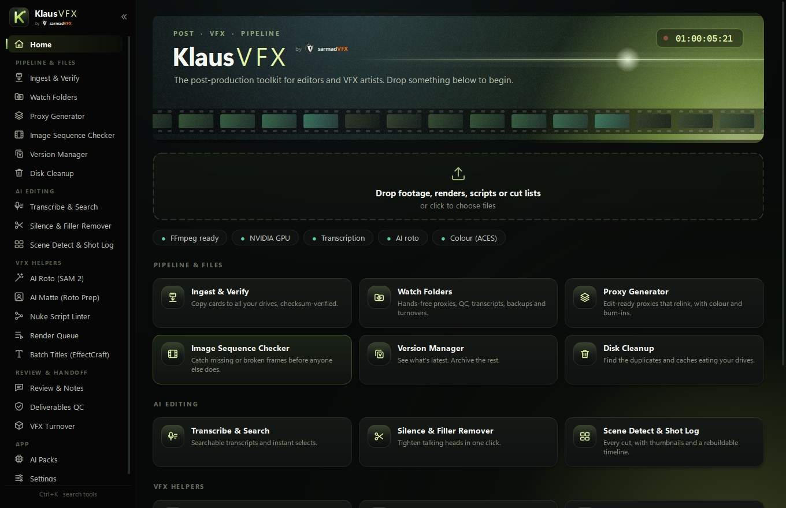
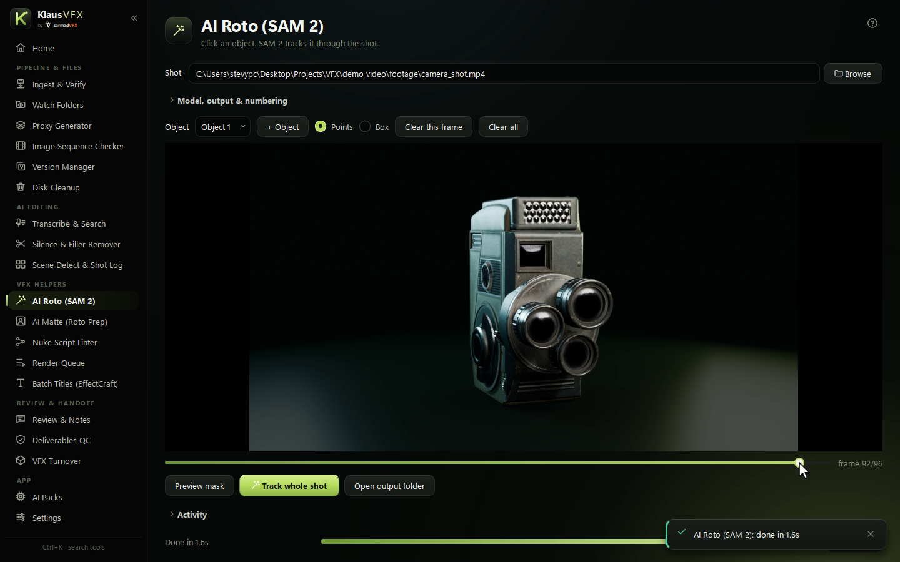
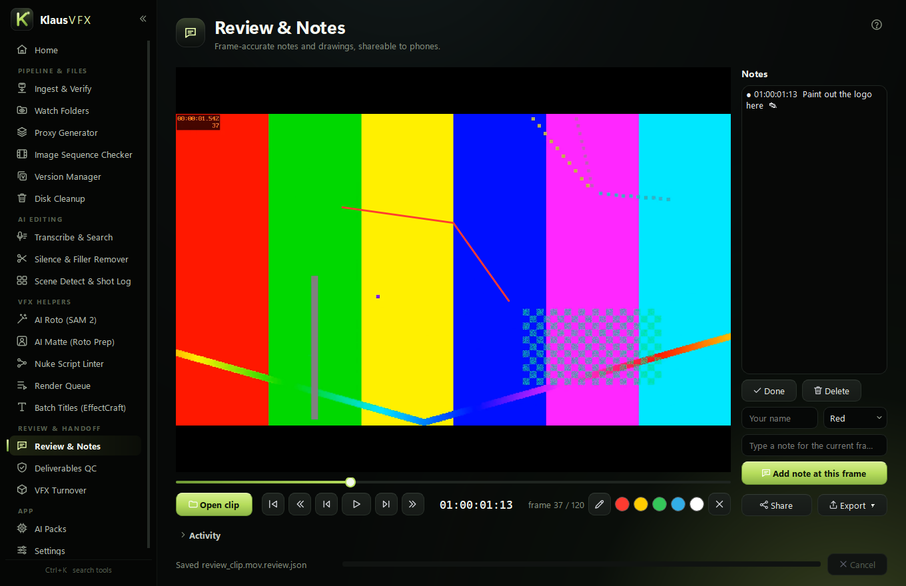

# KlausVFX

*by sarmadVFX*

**The post-production toolkit for editors and VFX artists.** KlausVFX takes care of the repetitive work around the
creative work: offloading cards, making proxies, transcribing, roto, review notes, QC and VFX turnovers.

**[⬇ Download the latest version](https://github.com/sarmadvfx1/KlausVFX/releases/latest)**: free, for Windows 10 & 11.

Everything runs on your own machine and nothing is uploaded anywhere. The only things that reach the network are the
optional AI downloads, the update check, and review links you share on your own network.

## Install

1. Download `KlausVFX-<version>-Setup.exe` from [Releases](https://github.com/sarmadvfx1/KlausVFX/releases/latest).
2. Run it. It installs for your user only, needs no admin rights, and includes FFmpeg.
3. The heavy AI features download as **AI packs** the first time you use them, or from the **AI Packs** page:

| Pack | Size | Used by |
|---|---|---|
| Transcription + AI mattes | ~450 MB | Transcribe, filler-word removal, AI Matte |
| NVIDIA GPU acceleration | ~1 GB | Much faster transcription on NVIDIA cards |
| SAM 2 roto (PyTorch) | ~4 GB | AI Roto |

Windows may show a SmartScreen warning the first time, because the installer isn't code-signed yet. Choose
**More info → Run anyway**.

KlausVFX checks this page for new versions when it starts and tells you when one is available.

## What's inside

**Pipeline & Files**
- **Ingest & Verify**: offload cards to several drives at once, with every file checksummed (xxHash64 / MD5 / SHA-1).
- **Watch Folders**: hands-free proxies, QC, transcripts, backups and turnovers for every new file.
- **Proxy Generator**: ProRes / DNxHR / H.264 proxies that keep timecode, with ACES 2.0 colour and burn-ins.
- **Image Sequence Checker**, **Version Manager**, **Disk Cleanup**.

**AI Editing**
- **Transcribe & Search**: local Whisper transcripts; export subtitles or selects (EDL, XML, FCPXML).
- **Silence & Filler Remover**: cut dead air and um/uh in one click.
- **Scene Detect & Shot Log**: every cut, with thumbnails and a timeline you can rebuild.

**VFX Helpers**
- **AI Roto (SAM 2)**: click an object once and it's tracked through the whole shot.
- **AI Matte**, **Nuke Script Linter**, **Render Queue** (Blender, Nuke, After Effects, EffectCraft), **Batch Titles**.

**Review & Handoff**
- **Review & Notes**: draw on frames and leave timecoded notes. Reviewers can add notes from their phone.
- **Deliverables QC**: check masters against a delivery spec, including loudness, black and frozen frames.
- **VFX Turnover**: EDL / XML / FCPXML / AAF in, shot list and plates out.

## Works with your tools

DaVinci Resolve · Premiere Pro · Avid (AAF) · Final Cut Pro (FCPXML) · Nuke · Blender · After Effects · EffectCraft · ACES / OCIO

## Feedback

Found a bug or want a feature? [Open an issue](https://github.com/sarmadvfx1/KlausVFX/issues).

## Licence

KlausVFX is free to use for personal and commercial work, but it is not open source: see [LICENSE](LICENSE.md).
It ships with open-source components (FFmpeg, Qt and others); their licences and source links are listed in
[THIRD-PARTY-NOTICES](THIRD-PARTY-NOTICES.md).
